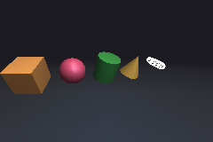

# lily3d: 3D graphics

`flower/lily3d` draws 3D scenes into any [drawing target](../TERRARIUM.md#drawing-targets): a window, a surface or an image. It is a software renderer written in lizard-script: the transforms, the camera, the lights, the culling and the clipping are all lizard code you can read in `terrarium/std/flower/lily3d/`. Only the last step, filling each triangle's pixels with a depth test, is done by the host, with the Terrarium's [`triangles`](../TERRARIUM.md#trianglestarget-list-options--).

```
use "flower/lily3d" as lily3d

let picture = img.new(320, 200)
let s = lily3d.scene()
lily3d.add(s, lily3d.cube(1), lily3d.rotate_y(30deg), {"color": #f2a65a})
lily3d.render(s, lily3d.camera((0, 1.5, 4), (0, 0, 0), 60deg), picture)
img.save(picture, "cube.png")
```



Examples: `examples/lily3d/cube.liz` (a lit cube spinning in a window; drag it, Space for its wireframe) and `examples/lily3d/teapot.liz` (the Utah teapot from an `.obj` file, rendered to a PNG). Run them on the VM, which is faster: `lizardscript --vm examples/lily3d/cube.liz`.

- [The space](#the-space)
- [Vectors](#vectors)
- [Matrices](#matrices)
- [Meshes](#meshes)
- [Shapes](#shapes)
- [.obj files](#obj-files)
- [Lights](#lights)
- [Cameras](#cameras)
- [Scenes and materials](#scenes-and-materials)
- [Rendering](#rendering)
- [Limits](#limits)

## The space

A point or a vector is a POINT with three coordinates, `(x, y, z)`, so `+`, `-`, `* number` and `/ number` already work on them. The space is right-handed: **x goes right, y goes up and z comes towards the viewer**. Angles are radians; write them with `deg` (`30deg`). A positive angle turns counterclockwise when its axis points at you.

A face's front is the side its corners go round counterclockwise. Every shape lily3d makes has its fronts outside.

Errors name the call: `lily3d.cube: size must be above 0, not 0`. They can be caught with `try`.

## Vectors

| Function | Gives |
| --- | --- |
| `dot(a, b)` | `a.x * b.x + a.y * b.y + a.z * b.z`: how much they point the same way |
| `cross(a, b)` | a vector at right angles to both; `cross((1, 0, 0), (0, 1, 0))` is `(0, 0, 1)` |
| `length(v)` | how long `v` is |
| `normalize(v)` | `v` made 1 long (the zero vector stays zero) |
| `lerp(a, b, t)` | `a` at 0, `b` at 1, in between for the rest |

```
puts(lily3d.cross((1, 0, 0), (0, 1, 0)), lily3d.length((2, 3, 6)), lily3d.normalize((0, 3, 4)))
-~> (0, 0, 1) 7.0 (0.0, 0.6, 0.8)
```

## Matrices

A transform is a 4x4 matrix: a list of 16 numbers, row by row, that takes the point `p` to `m * p` (with `p` as a column and a fourth coordinate 1).

| Function | Gives |
| --- | --- |
| `identity()` | the matrix that changes nothing |
| `translate(offset)` | moves by the 3D point `offset` |
| `scale(s)` | sizes by a number, or by `(sx, sy, sz)` |
| `rotate_x(angle)`, `rotate_y(angle)`, `rotate_z(angle)` | turns round an axis |
| `rotate(axis, angle)` | turns round any axis through the origin |
| `compose(first, second)` | does `first`, then `second` |
| `compose([m1, m2, ...])` | does each, in order |
| `multiply(a, b)` | the product `a * b` (which does `b` first) |
| `apply(m, p)` | the point `p` moved by `m` |
| `apply_direction(m, v)` | the direction `v` turned by `m`, without its move |
| `project(m, p)` | `[x, y, z, w]`: `p` through a projection, its clip coordinates |
| `transpose(m)` | rows and columns swapped |
| `inverse(m)` | the matrix that undoes `m`, or `null` when none does (it flattens space) |
| `normal_matrix(m)` | the transpose of the inverse: turns normals so they stay at right angles to a stretched surface |
| `look_at(eye, target, up = (0, 1, 0))` | a camera's view: the world as seen from `eye` looking at `target` |
| `perspective(fov, aspect, near, far)` | a perspective projection: `fov` from the bottom to the top of the view, `aspect` its width / height |
| `orthographic(width, height, near, far)` | an orthographic projection of a box `width` by `height` |

```
let spin = lily3d.compose([lily3d.scale(2), lily3d.rotate_z(90deg), lily3d.translate((1, 0, 0))])
puts(lily3d.apply(spin, (1, 0, 0)))   -~> about (1, 2, 0): sized to (2, 0, 0), turned to (0, 2, 0), moved
```

The projections follow OpenGL: a point is seen when its clip coordinates have `-w <= z <= w`, the near plane at `z = -w` and the far one at `z = w`.

## Meshes

A mesh is a hash:

| Key | What it is |
| --- | --- |
| `positions` | the corners, `[(x, y, z), ...]` |
| `normals` | for each corner, the way the surface faces there, 1 long |
| `faces` | triangles, `[[a, b, c], ...]`, by the indexes of their corners |

A corner where faces meet at a sharp edge (a cube's) is in the list once per face, each copy with that face's normal.

| Function | Gives |
| --- | --- |
| `mesh(positions, faces, normals = null)` | a checked mesh; without normals, each corner gets the average of the faces round it |
| `face_normal(a, b, c)` | the normal of a triangle, out of its front |
| `smooth_normals(m)` | a normal per corner: the faces round it added up by their area |
| `facets(m)` | the mesh with every face on its own corners, so it looks cut from facets |
| `bounds(m)` | `{"min": point, "max": point}`, the box round it |
| `fit(m, size = 1)` | the matrix that moves its box to the origin and sizes its longest side to `size` |
| `transformed(m, t)` | the mesh with its positions moved and its normals turned by `t` |
| `merge(meshes)` | one mesh of a list of them |

```
let tent = lily3d.mesh([(0, 0, 0), (1, 1, 0), (2, 0, 0), (1, 1, -1)], [[0, 2, 1], [2, 3, 1]])
puts(len(tent.normals), lily3d.bounds(tent).max)   -~> 4 (2, 1, 0)
```

## Shapes

Each is centered on the origin and, by default, fits a box 1 on a side. `detail` is how many steps go round a round one: more is smoother and slower.

| Function | Shape |
| --- | --- |
| `cube(size = 1)` | a cube with flat faces |
| `plane(size = 1, divisions = 1)` | a square on the ground (y = 0), facing up, cut into `divisions` by `divisions` squares |
| `sphere(radius = 0.5, detail = 24)` | a ball, `detail` steps round and `detail / 2` from pole to pole |
| `cylinder(radius = 0.5, height = 1, detail = 24)` | a tube along y, closed at both ends |
| `cone(radius = 0.5, height = 1, detail = 24)` | a cone along y, its point up, its base closed |
| `torus(radius = 0.35, tube = 0.15, detail = 32, tube_detail = 16)` | a ring round y: `radius` to the middle of the tube, `tube` its own radius |
| `surface(rows, cols, at)` | a mesh of your own: `at(u, v)`, with `u` and `v` from 0 to 1, gives `[position, normal]`; its front is the side of `cross(du, dv)`, and faces with no area (at a pole) are left out |

```
-~> A wavy sheet, 20 by 20 squares.
let sheet = lily3d.surface(20, 20, function(u, v) {
  let y = 0.1 * math.sin(v * 4 * math.pi)
  [(v * 2 - 1, y, u * 2 - 1), (0, 1, 0)]
})
let sheet_smooth = lily3d.mesh(sheet.positions, sheet.faces)   -~> normals from its faces
```

## .obj files

| Function | Gives |
| --- | --- |
| `load_obj(path)` | the mesh of a Wavefront `.obj` file |
| `parse_obj(text)` | the mesh of the text of one |

They read `v x y z` (positions), `vn x y z` (normals) and `f a b c ...` (faces). A face's corners are numbers from 1 (a negative one counts back from the last) and can be `a/t/n` or `a//n` to give a normal. A face with more corners is cut into triangles from its first. Everything else (texture coordinates, groups, materials, comments) is skipped. With normals for every corner, each pair of position and normal is a corner; without, each corner gets the average of its faces. A mistake says where: `lily3d.load_obj: line 12: there is no position 40, only 39 so far`.

```
let pot = lily3d.load_obj(fs.join(os.program_dir(), "teapot.obj"))
lily3d.add(s, pot, lily3d.fit(pot, 3), {"color": #3b6ea5, "shine": 40})
```

## Lights

| Function | Light |
| --- | --- |
| `ambient(color = #ffffff, strength = 0.25)` | from everywhere: keeps the side in shadow from going black |
| `directional(direction, color = #ffffff, strength = 1)` | parallel rays going `direction`, like the sun's |
| `point_light(position, color = #ffffff, strength = 1, range = 0)` | from one point; with a `range` above 0 it fades to nothing at that distance, as `(1 - distance / range)²` |

A surface's color is its color times the light reaching it (more the more it faces the light: Lambert), plus, when its material has `shine`, a highlight (Blinn-Phong). Lights above 1 in all make a color brighter, up to white. A scene with no lights gets a soft ambient one and a sun from the upper left, in front.

## Cameras

| Function | Camera |
| --- | --- |
| `camera(eye, target, fov = 60deg, options = {})` | perspective: far things look smaller; `fov` from the bottom of the view to its top |
| `ortho_camera(eye, target, height = 2, options = {})` | orthographic: everything keeps its size, like a technical drawing; `height` of the world fits the view top to bottom |

The options are `near` (0.1) and `far` (100), the distances between which things are seen, and `up` (`(0, 1, 0)`), the way that is up on the screen. A camera is a hash: change `cam.eye` or `cam.target` between frames to move it. The width of the view follows the target's shape.

## Scenes and materials

### scene(options = {})
A new scene. The options:

| Option | Default | What it does |
| --- | --- | --- |
| `background` | `#000000` | the color the target is cleared to before each render; `false` draws over what is there |
| `lights` | `[]` | the lights; with none, the default ones |
| `fog` | none | `{"color": c, "near": n, "far": f}`: things fade into `c` from `n` to `f` away from the eye |

### add(scene, mesh, transform = identity(), material = {})
Adds the mesh, moved by `transform`, and gives the object: `{"mesh", "transform", "material", "visible"}`. Keep it and change it between frames: `box.transform = lily3d.rotate_y(t)`, `box.material.color = #3fa34d`, `box.visible = false`. One mesh can be added many times with different transforms.

A material is a hash; every key can be left out, and an unknown one is an error:

| Key | Default | What it does |
| --- | --- | --- |
| `color` | `#d0d0d0` | the surface's color; with alpha it sees through (drawn after the solid objects) |
| `shading` | `"smooth"` | `"smooth"`: lit at each corner and mixed across (Gouraud), so round things look round; `"flat"`: one color per triangle |
| `lit` | `true` | `false` paints the color as it is |
| `shine` | `0` | above 0, a highlight, smaller the bigger it is (8 is dull, 64 glossy) |
| `specular` | `0.5` | how bright the highlight is |
| `cull` | `true` | `false` draws the back of faces too, lit from their back (a plane seen from both sides, an open model) |
| `wireframe` | `false` | `true` draws only the edges, in the lit colors; a color draws the edges in it over the faces |
| `line_width` | `1` | how wide the edges are, in pixels |

### remove(scene, object), light(scene, light)
`remove` takes an object out (fine when it isn't there); `light` adds a light and gives it.

## Rendering

### render(scene, camera, target)
Draws the scene and gives how many triangles were filled. The target's background (unless `false`) and its depth are cleared first. For each object it:

1. moves the corners into the world (its transform) and into clip space (the camera's view and projection);
2. leaves out the faces whose back is towards the camera (unless `cull` is off);
3. lights the corners, or each face's middle with flat shading, and fades them into the fog;
4. cuts the triangles that cross the near or far plane (Sutherland-Hodgman) and puts the corners on the screen;
5. fills them with `img.triangles`, which keeps the nearest pixel.

```
let w = window.open(600, 400, "spin")
let s = lily3d.scene({"background": #1d1b22})
let box = lily3d.add(s, lily3d.cube(1.4), lily3d.identity(), {"color": #f2a65a, "shine": 24})
let cam = lily3d.camera((0, 1.5, 4), (0, 0, 0), 60deg)
let t = 0
window.run(w, function(events) {
  t += 1
  box.transform = lily3d.compose(lily3d.rotate_y(t * 0.012), lily3d.rotate_x(t * 0.004))
  lily3d.render(s, cam, w)
})
```

On the VM, `examples/lily3d/cube.liz` (a lit cube at 600x400) keeps its window at 60 frames a second with about 1 ms of work a frame; headless, with no screen to wait for, it draws about 240 a second (`tests/lily3d/cube_bench.liz`). The teapot (6320 triangles) renders at 640x480 in about 30 ms.

### screen_point(camera, size, p)
Where the world point `p` lands on a target of `size` (a point `(w, h)`): `(x, y, depth)`, or `null` when it is not between the near and far planes. For a label next to a 3D thing:
```
let at = lily3d.screen_point(cam, window.size(w), (0, 1, 0))
```

## Limits

- Lighting and fog are worked out at the corners and mixed across a triangle, so a big triangle can't show a spot of light or fog in its middle: cut it into smaller ones (`plane(40, 20)` instead of `plane(40)`).
- Colors are mixed across a triangle on the screen, not in 3D (no perspective correction), which shows only on big triangles seen at a slant.
- Edges are not anti-aliased, and there are no textures or shadows.
- Objects that see through are drawn after the solid ones, in the order they were added, not sorted by distance.
- A corner more than 2,097,152 pixels off the target is pulled in, which bends the triangle; only a camera inside a huge object gets there.
