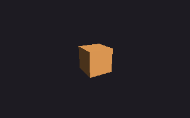
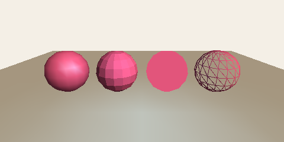
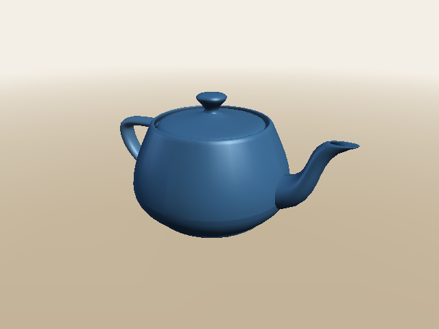

# 20. lily3d: 3D graphics

[← Previous: lily2d](19-lily2d.md) · [Index](../README.md) · [Cheat sheet →](cheatsheet.md) · [Español](../es/20-lily3d.md)

`lily3d` is the 3D library of **flower**, lizard-script's family of graphics libraries. It draws cubes, balls, teapots, whole scenes with lights and fog, into an image, a window or a surface. It is written in lizard-script itself, so everything it does (moving shapes, pointing a camera, lighting, hiding what is behind) is code you can read in `terrarium/std/flower/lily3d/`, one idea per file. This chapter uses it, and then opens it up to show how a 3D picture is made.

Every function is in the reference, [LILY3D.md](../../flower/LILY3D.md).

## A first picture

```
use "flower/lily3d" as lily3d

let picture = img.new(320, 200)
let s = lily3d.scene({"background": #1d1b22})
lily3d.add(s, lily3d.cube(1), lily3d.rotate_y(30deg), {"color": #f2a65a})
let count = lily3d.render(s, lily3d.camera((0, 1.5, 4), (0, 0, 0), 60deg), picture)
img.save(picture, "first.png")
puts("drew", count, "triangles")
```

**Output:**

```text
drew 6 triangles
```



- `use "flower/lily3d" as lily3d` loads the library. It comes with every `lizardscript`, so there is nothing to install. The `as lily3d` matters: every function is then `lily3d.something`.
- A **scene** holds what there is to see. `add` puts a **mesh** in it (here a cube 1 on a side), moved by a **transform** (turned 30° round the vertical axis), with a **material** (its color).
- A **camera** says where the scene is seen from: its eye at `(0, 1.5, 4)`, looking at the origin, with a field of view of 60°.
- `render` draws the scene into the picture and says how many triangles it filled. A cube has 12 triangles (two per face), but only the three faces turned towards the camera are drawn: 6.

## The space

A position in 3D is a point with three coordinates, `(x, y, z)`. **x goes right, y goes up, and z comes out of the screen towards you.** So the camera above, at `z = 4`, is in front of the cube, a little above it.

Points already add, subtract and multiply by numbers ([chapter 12](12-colors-and-points.md)). lily3d adds what 3D needs:

```
use "flower/lily3d" as lily3d

let a = (1, 0, 0)
let b = (0, 1, 0)
puts(a + b, a * 3)
puts(lily3d.dot(a, b), lily3d.dot(a, a))
puts(lily3d.cross(a, b))
puts(lily3d.length((2, 3, 6)), lily3d.normalize((0, 3, 4)))
```

**Output:**

```text
(1, 1, 0) (3, 0, 0)
0 1
(0, 0, 1)
7.0 (0.0, 0.6, 0.8)
```

- `dot` is 0 when two directions are at right angles, and big when they point the same way. That is how lily3d knows how much a face looks at a light.
- `cross` gives a direction at right angles to both: the x axis crossed with the y axis is the z axis. That is how it finds which way a triangle faces.
- `normalize` keeps the direction and makes it 1 long.

## Moving things: matrices

A transform is a **matrix**: a list of 16 numbers that moves every point of a shape the same way. You rarely look inside one; you make them and combine them.

```
use "flower/lily3d" as lily3d

let p = (1, 0, 0)
puts(lily3d.apply(lily3d.translate((0, 2, 0)), p))
puts(lily3d.apply(lily3d.scale(3), p))
let turn = lily3d.apply(lily3d.rotate_z(90deg), p)
puts(turn)
puts(math.round(turn.x * 1000) / 1000.0, turn.y)

let move_then_turn = lily3d.compose(lily3d.translate((2, 0, 0)), lily3d.rotate_z(90deg))
let turn_then_move = lily3d.compose(lily3d.rotate_z(90deg), lily3d.translate((2, 0, 0)))
let r = function(v) { (math.round(v.x), math.round(v.y), math.round(v.z)) }
puts(r(lily3d.apply(move_then_turn, p)), r(lily3d.apply(turn_then_move, p)))
```

**Output:**

```text
(1.0, 2.0, 0.0)
(3.0, 0.0, 0.0)
(6.123233995736757e-17, 1.0, 0.0)
0.0 1.0
(0, 3, 0) (2, 1, 0)
```

- `rotate_z(90deg)` turns `(1, 0, 0)` a quarter turn counterclockwise, to `(0, 1, 0)`. The `6.12e-17` is a float that is 0 up to rounding: `math.cos(90deg)` isn't exactly 0 ([chapter 11](11-numbers-and-math.md)).
- `compose(first, second)` does `first`, then `second`, and **the order matters**: moving to `(3, 0, 0)` and then turning round the origin lands on `(0, 3, 0)`; turning first and then moving lands on `(2, 1, 0)`. To spin a thing in its place and put it somewhere, turn first and move last.
- `compose([a, b, c])` does a list in order: `compose([scale(2), rotate_y(t), translate((0, 1, 0))])`.

## Shapes and meshes

A shape is a **mesh**: a list of corners (`positions`), the way the surface faces at each one (`normals`), and triangles that join them by their numbers (`faces`).

```
use "flower/lily3d" as lily3d

let box = lily3d.cube(1)
puts(len(box.positions), "corners,", len(box.faces), "faces")
puts(box.faces[0], box.positions[0], box.normals[0])
let ball = lily3d.sphere(0.5, 8)
puts(len(ball.positions), "corners,", len(ball.faces), "faces")
let tri = lily3d.mesh([(0, 0, 0), (1, 0, 0), (0, 1, 0)], [[0, 1, 2]])
puts(tri.normals)
```

**Output:**

```text
24 corners, 12 faces
[0, 2, 3] (0.5, -0.5, 0.5) (1.0, 0.0, 0.0)
45 corners, 48 faces
[(0.0, 0.0, 1.0), (0.0, 0.0, 1.0), (0.0, 0.0, 1.0)]
```

- A cube has 8 corners, but its mesh has 24: each corner is there once for each of the three faces that meet at it, with that face's normal, so the edges stay sharp.
- A sphere's `detail` is how many steps go round it: 8 is blocky, 24 (the default) looks round.
- `mesh(positions, faces)` makes your own; it works out the normals. A triangle's corners go **counterclockwise seen from its front**: `(0, 0, 0)`, `(1, 0, 0)`, `(0, 1, 0)` turn counterclockwise seen from `+z`, so its normal is `(0, 0, 1)`.

The shapes are `cube`, `sphere`, `plane`, `cylinder`, `cone` and `torus`, each the size of a box 1 on a side unless you say otherwise. `surface(rows, cols, at)` makes any other shape from a function (see the reference).

## Materials and lights

```
use "flower/lily3d" as lily3d

let picture = img.new(480, 240)
let s = lily3d.scene({"background": #f4efe6})
lily3d.light(s, lily3d.ambient(#ffffff, 0.3))
lily3d.light(s, lily3d.directional((-1, -1, -1), #fff1dc, 0.8))
lily3d.light(s, lily3d.point_light((0, 1, 1.5), #5aa0f2, 1, 4))

lily3d.add(s, lily3d.plane(10, 10), lily3d.translate((0, -0.5, 0)), {"color": #d8ccb6})
let ball = lily3d.sphere(0.5, 16)
lily3d.add(s, ball, lily3d.translate((-1.8, 0, 0)), {"color": #e2557b, "shine": 32})
lily3d.add(s, ball, lily3d.translate((-0.6, 0, 0)), {"color": #e2557b, "shading": "flat"})
lily3d.add(s, ball, lily3d.translate((0.6, 0, 0)), {"color": #e2557b, "lit": false})
lily3d.add(s, ball, lily3d.translate((1.8, 0, 0)), {"color": #e2557b, "wireframe": true})

let cam = lily3d.camera((0, 1.2, 3.5), (0, 0, 0), 50deg)
puts("drew", lily3d.render(s, cam, picture), "triangles")
img.save(picture, "materials.png")
```

**Output:**

```text
drew 482 triangles
```



The same ball, added four times with four materials:

1. **Smooth** shading (the default) with `"shine": 32`: lit at each corner and mixed across each triangle, so it looks round, with a highlight.
2. `"shading": "flat"`: one color per triangle, so you see its facets.
3. `"lit": false`: its color as it is. With no light and shade, a ball is a disc.
4. `"wireframe": true`: only the edges of its triangles.

The three kinds of light: `ambient` comes from everywhere, so the side in shadow doesn't go black; `directional` is parallel rays like the sun's, going `(-1, -1, -1)` (down, to the left, away from you); `point_light` shines from one point, fading over 4 units (the blue on the floor). A scene with no lights gets a soft ambient light and a sun.

> **Try it.** Change the point light's color, or move it with `(x, 1, 1.5)` for a few values of `x`. Give the wireframe ball `"wireframe": #1d1b22` instead: its edges are drawn over its faces.

## Moving pictures

In a window, change the objects and render again every frame. `add` gives the object it added; keep it and change its `transform`:

```
use "flower/lily3d" as lily3d

let w = window.open(600, 400, "spin")
let s = lily3d.scene({"background": #1d1b22})
let box = lily3d.add(s, lily3d.cube(1.4), lily3d.identity(), {"color": #f2a65a, "shine": 24})
let cam = lily3d.camera((0, 1.5, 4), (0, 0, 0), 60deg)
let t = 0
window.run(w, function(events) {
  t += 1
  box.transform = lily3d.compose(lily3d.rotate_y(t * 0.012), lily3d.rotate_x(t * 0.004))
  lily3d.render(s, cam, w)
})
```

`examples/lily3d/cube.liz` is this with lights, dragging to turn it, Space for the wireframe and the frames a second in the title. Run it on the VM, the faster engine: `lizardscript --vm examples/lily3d/cube.liz`. It keeps the window at 60 frames a second with about a millisecond of work in each.

## Models from other programs

3D programs (Blender and most others) can save a model as an **.obj** file, which `load_obj` reads:

```
use "flower/lily3d" as lily3d

let pot = lily3d.load_obj("examples/lily3d/teapot.obj")
puts(len(pot.positions), "corners,", len(pot.faces), "faces")
let b = lily3d.bounds(pot)
puts(b.min, b.max)
let fitted = lily3d.fit(pot, 2)
let small = lily3d.bounds(lily3d.transformed(pot, fitted))
puts(small.max.x - small.min.x)
```

**Output:**

```text
3644 corners, 6320 faces
(-3.0, 0.0, -2.0) (3.434, 3.15, 2.0)
2.0
```

A model comes in whatever units its author used: this teapot is more than 6 wide. `fit(mesh, size)` is the transform that centers it and makes its longest side `size`, so it fits your camera. `examples/lily3d/teapot.liz` renders it:



## How a 3D picture is made

`render` does five steps for each object. They are the same steps a graphics card does, in a few hundred lines you can read in `terrarium/std/flower/lily3d/render.liz`.

1. **Transform.** Each corner is moved into the world by the object's transform, then into the camera's view (`look_at`) and through its **projection** (`perspective`). The projection is what makes far things small: a corner's `x` and `y` are divided by how far it is.
2. **Cull.** A triangle whose back faces the camera is on the far side of a closed shape, so it is left out. That is why the cube drew 6 triangles, not 12.
3. **Light.** Each corner's color is its material's color times the light reaching it: more the more its normal points at the light (`dot(normal, towards_light)`).
4. **Clip.** A triangle that crosses the plane just in front of the camera is cut along it (the polygon of the part in front is kept), because a point behind the eye has no place on the screen.
5. **Fill.** The Terrarium's `img.triangles` paints the triangles' pixels. It keeps a **depth buffer**: for each pixel, how far away the nearest thing painted there is. A pixel is only painted when it is nearer, so a near object hides a far one whatever order they are drawn in.

Only step 5 runs in Go: it is the one that works pixel by pixel. `screen_point` shows steps 1 and 4 for one point: where it lands on a target, and its depth from 0 (at the near plane) to 1 (at the far one):

```
use "flower/lily3d" as lily3d

let cam = lily3d.camera((0, 0, 5), (0, 0, 0), 60deg)
let size = (200, 100)
puts(lily3d.screen_point(cam, size, (0, 0, 0)))
puts(lily3d.screen_point(cam, size, (1, 0, 0)))
puts(lily3d.screen_point(cam, size, (1, 0, -5)))
puts(lily3d.screen_point(cam, size, (0, 0, 6)))
```

**Output:**

```text
(100.0, 50.0, 0.980980980980981)
(117.32050807568876, 50.0, 0.980980980980981)
(108.66025403784438, 50.0, 0.990990990990991)
null
```

- The origin, where the camera looks, lands in the middle of the 200 by 100 target.
- `(1, 0, 0)` is 17 pixels to the right. The same step to the right but 5 farther away, `(1, 0, -5)`, is only half as far from the middle: that is perspective. It is also deeper.
- `(0, 0, 6)` is behind the camera (at `z = 5`): `null`.

> **Try it.** Change the camera to `lily3d.ortho_camera((0, 0, 5), (0, 0, 0), 2)`: an orthographic camera doesn't divide by the distance, so `(1, 0, 0)` and `(1, 0, -5)` land on the same pixel.

## Common mistakes

**Forgetting `as lily3d`.** Without it, `use` gives the module's names on their own, and `lily3d` is not one of them:

```
use "flower/lily3d"
puts(lily3d.cube(1))
```

**Output:**

```text
[line 2, column 6] runtime error: identifier not found: lily3d
```

**A 2D point where a 3D one goes:**

```
use "flower/lily3d" as lily3d
let s = lily3d.scene()
lily3d.add(s, lily3d.cube(1), lily3d.translate((0, 1)))
```

**Output:**

```text
std:/flower/lily3d/check.liz: [line 8, column 8] runtime error: lily3d.translate: offset must be a 3D point like (0, 1, 2), not (0, 1)
```

The message says which call was wrong. The place in front of it is inside the library, where the check is (`std:` is where the standard modules live); look for the call in your own program.

**A misspelled material key** is an error, not a silent mistake:

```
use "flower/lily3d" as lily3d
let s = lily3d.scene()
lily3d.add(s, lily3d.cube(1), lily3d.identity(), {"colour": #f2a65a})
```

**Output:**

```text
std:/flower/lily3d/check.liz: [line 8, column 8] runtime error: lily3d.add: unknown material key "colour" (the material keys are color, cull, line_width, lit, shading, shine, specular, wireframe)
```

**Nothing shows.** The usual reasons: the camera looks away from the object (check `target`), it is inside the object (all its faces turn their backs: move the eye out, or use `"cull": false`), or the object is beyond `far` (100 by default).

**Fog or a light doesn't change across a big floor.** Light and fog are worked out at the corners and mixed across each triangle, and `plane(40)` has only 4 corners. Cut it into squares: `plane(40, 20)`.

## Summary

- `use "flower/lily3d" as lily3d`; a `scene`, objects `add`ed to it, a `camera`, and `render(scene, camera, target)` into an image, a window or a surface.
- Points `(x, y, z)` are positions and directions: x right, y up, z towards you. `dot`, `cross`, `length`, `normalize`.
- Transforms are matrices: `translate`, `scale`, `rotate_x/y/z`, `rotate`, and `compose`, which does them in order.
- Meshes are corners, normals and triangles; `cube`, `sphere`, `plane`, `cylinder`, `cone`, `torus`, `surface`, `mesh`, and `load_obj` for `.obj` files.
- Materials: `color`, `shading` (`"smooth"` or `"flat"`), `lit`, `shine`, `cull`, `wireframe`. Lights: `ambient`, `directional`, `point_light`. A scene can have `fog`.
- A picture is made by transforming, culling, lighting, clipping and filling with a depth buffer; only the filling is not lizard-script.

[← Previous: lily2d](19-lily2d.md) · [Index](../README.md) · [Cheat sheet →](cheatsheet.md)
