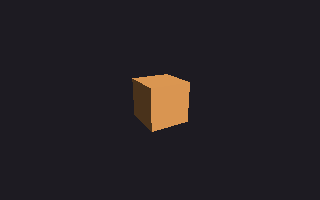
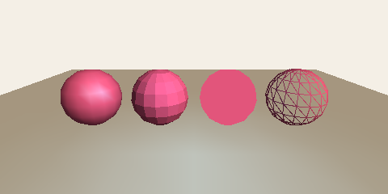
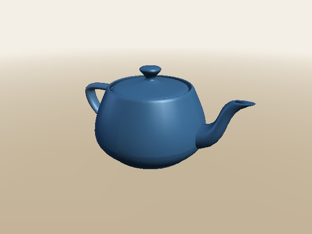

# 20. lily3d: gráficos 3D

[← Anterior: lily2d](19-lily2d.md) · [Índice](../README.md) · [Hoja de referencia →](cheatsheet.md) · [English](../en/20-lily3d.md)

`lily3d` es la biblioteca 3D de **flower**, la familia de bibliotecas gráficas de lizard-script. Dibuja cubos, esferas, teteras y escenas enteras con luces y niebla, en una imagen, una ventana o una superficie. Está escrita en lizard-script, así que todo lo que hace (mover figuras, apuntar una cámara, iluminar, esconder lo que queda detrás) es código que puedes leer en `terrarium/std/flower/lily3d/`, una idea por archivo. Este capítulo la usa y después la abre para mostrar cómo se hace una imagen 3D.

Cada función está en la referencia, [LILY3D.md](../../flower/LILY3D.md) (en inglés).

## Una primera imagen

```
use "flower/lily3d" as lily3d

let picture = img.new(320, 200)
let s = lily3d.scene({"background": #1d1b22})
lily3d.add(s, lily3d.cube(1), lily3d.rotate_y(30deg), {"color": #f2a65a})
let count = lily3d.render(s, lily3d.camera((0, 1.5, 4), (0, 0, 0), 60deg), picture)
img.save(picture, "first.png")
puts("drew", count, "triangles")
```

**Salida:**

```text
drew 6 triangles
```



- `use "flower/lily3d" as lily3d` carga la biblioteca. Viene con todo `lizardscript`, así que no hay nada que instalar. El `as lily3d` importa: así cada función es `lily3d.algo`.
- Una **escena** guarda lo que hay para ver. `add` pone en ella una **malla** (aquí un cubo de 1 de lado), movida por una **transformación** (girada 30° alrededor del eje vertical), con un **material** (su color).
- Una **cámara** dice desde dónde se ve la escena: su ojo en `(0, 1.5, 4)`, mirando al origen, con un campo de visión de 60°.
- `render` dibuja la escena en la imagen y dice cuántos triángulos rellenó. Un cubo tiene 12 triángulos (dos por cara), pero solo se dibujan las tres caras que miran a la cámara: 6.

## El espacio

Una posición en 3D es un punto de tres coordenadas, `(x, y, z)`. **x va a la derecha, y va hacia arriba y z sale de la pantalla hacia ti.** Así que la cámara de arriba, en `z = 4`, está delante del cubo y un poco por encima.

Los puntos ya se suman, se restan y se multiplican por números ([capítulo 12](12-colors-and-points.md)). lily3d añade lo que necesita el 3D:

```
use "flower/lily3d" as lily3d

let a = (1, 0, 0)
let b = (0, 1, 0)
puts(a + b, a * 3)
puts(lily3d.dot(a, b), lily3d.dot(a, a))
puts(lily3d.cross(a, b))
puts(lily3d.length((2, 3, 6)), lily3d.normalize((0, 3, 4)))
```

**Salida:**

```text
(1, 1, 0) (3, 0, 0)
0 1
(0, 0, 1)
7.0 (0.0, 0.6, 0.8)
```

- `dot` (producto punto) da 0 cuando dos direcciones forman un ángulo recto, y es grande cuando apuntan al mismo lado. Así sabe lily3d cuánto mira una cara hacia una luz.
- `cross` (producto cruz) da una dirección perpendicular a las dos: el eje x cruzado con el eje y es el eje z. Así encuentra hacia dónde mira un triángulo.
- `normalize` conserva la dirección y la deja de largo 1.

## Mover cosas: matrices

Una transformación es una **matriz**: una lista de 16 números que mueve todos los puntos de una figura de la misma manera. Casi nunca se mira por dentro; se crean y se combinan.

```
use "flower/lily3d" as lily3d

let p = (1, 0, 0)
puts(lily3d.apply(lily3d.translate((0, 2, 0)), p))
puts(lily3d.apply(lily3d.scale(3), p))
let turn = lily3d.apply(lily3d.rotate_z(90deg), p)
puts(turn)
puts(math.round(turn.x * 1000) / 1000.0, turn.y)

let move_then_turn = lily3d.compose(lily3d.translate((2, 0, 0)), lily3d.rotate_z(90deg))
let turn_then_move = lily3d.compose(lily3d.rotate_z(90deg), lily3d.translate((2, 0, 0)))
let r = function(v) { (math.round(v.x), math.round(v.y), math.round(v.z)) }
puts(r(lily3d.apply(move_then_turn, p)), r(lily3d.apply(turn_then_move, p)))
```

**Salida:**

```text
(1.0, 2.0, 0.0)
(3.0, 0.0, 0.0)
(6.123233995736757e-17, 1.0, 0.0)
0.0 1.0
(0, 3, 0) (2, 1, 0)
```

- `rotate_z(90deg)` gira `(1, 0, 0)` un cuarto de vuelta en sentido antihorario, hasta `(0, 1, 0)`. El `6.12e-17` es un flotante que vale 0 salvo por el redondeo: `math.cos(90deg)` no da exactamente 0 ([capítulo 11](11-numbers-and-math.md)).
- `compose(first, second)` hace `first` y luego `second`, y **el orden importa**: mover hasta `(3, 0, 0)` y luego girar alrededor del origen termina en `(0, 3, 0)`; girar primero y mover después termina en `(2, 1, 0)`. Para hacer girar algo en su sitio y ponerlo en otro lugar, gira primero y mueve al final.
- `compose([a, b, c])` hace una lista en orden: `compose([scale(2), rotate_y(t), translate((0, 1, 0))])`.

## Figuras y mallas

Una figura es una **malla**: una lista de esquinas (`positions`), hacia dónde mira la superficie en cada una (`normals`, las normales) y triángulos que las unen por sus números (`faces`).

```
use "flower/lily3d" as lily3d

let box = lily3d.cube(1)
puts(len(box.positions), "corners,", len(box.faces), "faces")
puts(box.faces[0], box.positions[0], box.normals[0])
let ball = lily3d.sphere(0.5, 8)
puts(len(ball.positions), "corners,", len(ball.faces), "faces")
let tri = lily3d.mesh([(0, 0, 0), (1, 0, 0), (0, 1, 0)], [[0, 1, 2]])
puts(tri.normals)
```

**Salida:**

```text
24 corners, 12 faces
[0, 2, 3] (0.5, -0.5, 0.5) (1.0, 0.0, 0.0)
45 corners, 48 faces
[(0.0, 0.0, 1.0), (0.0, 0.0, 1.0), (0.0, 0.0, 1.0)]
```

- Un cubo tiene 8 esquinas, pero su malla tiene 24: cada esquina está una vez por cada una de las tres caras que se juntan en ella, con la normal de esa cara, para que las aristas sigan marcadas.
- El `detail` de una esfera es cuántos pasos le dan la vuelta: 8 se ve en bloques, 24 (el valor por defecto) se ve redonda.
- `mesh(positions, faces)` crea una propia; calcula las normales. Las esquinas de un triángulo van **en sentido antihorario vistas desde su frente**: `(0, 0, 0)`, `(1, 0, 0)`, `(0, 1, 0)` giran en sentido antihorario vistas desde `+z`, así que su normal es `(0, 0, 1)`.

Las figuras son `cube`, `sphere`, `plane`, `cylinder`, `cone` y `torus`, cada una del tamaño de una caja de 1 de lado si no se pide otro. `surface(rows, cols, at)` hace cualquier otra figura a partir de una función (mira la referencia).

## Materiales y luces

```
use "flower/lily3d" as lily3d

let picture = img.new(480, 240)
let s = lily3d.scene({"background": #f4efe6})
lily3d.light(s, lily3d.ambient(#ffffff, 0.3))
lily3d.light(s, lily3d.directional((-1, -1, -1), #fff1dc, 0.8))
lily3d.light(s, lily3d.point_light((0, 1, 1.5), #5aa0f2, 1, 4))

lily3d.add(s, lily3d.plane(10, 10), lily3d.translate((0, -0.5, 0)), {"color": #d8ccb6})
let ball = lily3d.sphere(0.5, 16)
lily3d.add(s, ball, lily3d.translate((-1.8, 0, 0)), {"color": #e2557b, "shine": 32})
lily3d.add(s, ball, lily3d.translate((-0.6, 0, 0)), {"color": #e2557b, "shading": "flat"})
lily3d.add(s, ball, lily3d.translate((0.6, 0, 0)), {"color": #e2557b, "lit": false})
lily3d.add(s, ball, lily3d.translate((1.8, 0, 0)), {"color": #e2557b, "wireframe": true})

let cam = lily3d.camera((0, 1.2, 3.5), (0, 0, 0), 50deg)
puts("drew", lily3d.render(s, cam, picture), "triangles")
img.save(picture, "materials.png")
```

**Salida:**

```text
drew 482 triangles
```



La misma esfera, añadida cuatro veces con cuatro materiales:

1. Sombreado **suave** (el de por defecto) con `"shine": 32`: se ilumina en cada esquina y se mezcla a lo largo de cada triángulo, así que se ve redonda, con un brillo.
2. `"shading": "flat"`: un color por triángulo, así que se ven sus facetas.
3. `"lit": false`: su color tal cual. Sin luces ni sombras, una esfera es un disco.
4. `"wireframe": true`: solo las aristas de sus triángulos.

Los tres tipos de luz: `ambient` viene de todas partes, para que el lado en sombra no quede negro; `directional` son rayos paralelos como los del sol, que van hacia `(-1, -1, -1)` (abajo, a la izquierda, alejándose de ti); `point_light` alumbra desde un punto y se apaga a lo largo de 4 unidades (el azul del piso). Una escena sin luces recibe una luz ambiente suave y un sol.

> **Pruébalo.** Cambia el color de la luz puntual, o muévela con `(x, 1, 1.5)` para varios valores de `x`. Dale a la esfera de alambre `"wireframe": #1d1b22`: sus aristas se dibujan sobre sus caras.

## Imágenes en movimiento

En una ventana, cambia los objetos y vuelve a dibujar en cada cuadro. `add` devuelve el objeto que añadió; guárdalo y cambia su `transform`:

```
use "flower/lily3d" as lily3d

let w = window.open(600, 400, "spin")
let s = lily3d.scene({"background": #1d1b22})
let box = lily3d.add(s, lily3d.cube(1.4), lily3d.identity(), {"color": #f2a65a, "shine": 24})
let cam = lily3d.camera((0, 1.5, 4), (0, 0, 0), 60deg)
let t = 0
window.run(w, function(events) {
  t += 1
  box.transform = lily3d.compose(lily3d.rotate_y(t * 0.012), lily3d.rotate_x(t * 0.004))
  lily3d.render(s, cam, w)
})
```

`examples/lily3d/cube.liz` es esto con luces, arrastrar para girarlo, Espacio para ver el alambre y los cuadros por segundo en el título. Ejecútalo en la VM, el motor más rápido: `lizardscript --vm examples/lily3d/cube.liz`. Mantiene la ventana a 60 cuadros por segundo con cerca de un milisegundo de trabajo en cada uno.

## Modelos de otros programas

Los programas 3D (Blender y casi todos los demás) pueden guardar un modelo como archivo **.obj**, que `load_obj` lee:

```
use "flower/lily3d" as lily3d

let pot = lily3d.load_obj("examples/lily3d/teapot.obj")
puts(len(pot.positions), "corners,", len(pot.faces), "faces")
let b = lily3d.bounds(pot)
puts(b.min, b.max)
let fitted = lily3d.fit(pot, 2)
let small = lily3d.bounds(lily3d.transformed(pot, fitted))
puts(small.max.x - small.min.x)
```

**Salida:**

```text
3644 corners, 6320 faces
(-3.0, 0.0, -2.0) (3.434, 3.15, 2.0)
2.0
```

Un modelo llega en las unidades que usó su autor: esta tetera mide más de 6 de ancho. `fit(mesh, size)` es la transformación que la centra y deja su lado más largo en `size`, para que quepa en tu cámara. `examples/lily3d/teapot.liz` la dibuja:



## Cómo se hace una imagen 3D

`render` hace cinco pasos para cada objeto. Son los mismos que hace una tarjeta gráfica, en unos cientos de líneas que puedes leer en `terrarium/std/flower/lily3d/render.liz`.

1. **Transformar.** Cada esquina se lleva al mundo con la transformación del objeto, luego a la vista de la cámara (`look_at`) y por su **proyección** (`perspective`). La proyección es lo que hace pequeño lo lejano: la `x` y la `y` de una esquina se dividen por lo lejos que está.
2. **Descartar caras traseras.** Un triángulo que le da la espalda a la cámara está en el lado de atrás de una figura cerrada, así que se omite. Por eso el cubo dibujó 6 triángulos y no 12.
3. **Iluminar.** El color de cada esquina es el color de su material por la luz que le llega: más cuanto más apunta su normal hacia la luz (`dot(normal, hacia_la_luz)`).
4. **Recortar.** Un triángulo que cruza el plano justo delante de la cámara se corta por ese plano (se queda el polígono de la parte de delante), porque un punto detrás del ojo no tiene lugar en la pantalla.
5. **Rellenar.** `img.triangles` del Terrario pinta los píxeles de los triángulos. Lleva un **búfer de profundidad**: para cada píxel, qué tan lejos está lo más cercano que se ha pintado ahí. Un píxel solo se pinta si está más cerca, así que un objeto cercano tapa uno lejano sin importar en qué orden se dibujen.

Solo el paso 5 corre en Go: es el que trabaja píxel por píxel. `screen_point` muestra los pasos 1 y 4 para un punto: dónde cae en un destino, y su profundidad, de 0 (en el plano cercano) a 1 (en el lejano):

```
use "flower/lily3d" as lily3d

let cam = lily3d.camera((0, 0, 5), (0, 0, 0), 60deg)
let size = (200, 100)
puts(lily3d.screen_point(cam, size, (0, 0, 0)))
puts(lily3d.screen_point(cam, size, (1, 0, 0)))
puts(lily3d.screen_point(cam, size, (1, 0, -5)))
puts(lily3d.screen_point(cam, size, (0, 0, 6)))
```

**Salida:**

```text
(100.0, 50.0, 0.980980980980981)
(117.32050807568876, 50.0, 0.980980980980981)
(108.66025403784438, 50.0, 0.990990990990991)
null
```

- El origen, adonde mira la cámara, cae en el centro del destino de 200 por 100.
- `(1, 0, 0)` queda 17 píxeles a la derecha. El mismo paso a la derecha pero 5 más lejos, `(1, 0, -5)`, queda a la mitad de distancia del centro: eso es la perspectiva. También está más profundo.
- `(0, 0, 6)` está detrás de la cámara (que está en `z = 5`): `null`.

> **Pruébalo.** Cambia la cámara por `lily3d.ortho_camera((0, 0, 5), (0, 0, 0), 2)`: una cámara ortográfica no divide por la distancia, así que `(1, 0, 0)` y `(1, 0, -5)` caen en el mismo píxel.

## Errores comunes

**Olvidar `as lily3d`.** Sin él, `use` da los nombres del módulo sueltos, y `lily3d` no es uno de ellos:

```
use "flower/lily3d"
puts(lily3d.cube(1))
```

**Salida:**

```text
[line 2, column 6] runtime error: identifier not found: lily3d
```

**Un punto 2D donde va uno 3D:**

```
use "flower/lily3d" as lily3d
let s = lily3d.scene()
lily3d.add(s, lily3d.cube(1), lily3d.translate((0, 1)))
```

**Salida:**

```text
std:/flower/lily3d/check.liz: [line 8, column 8] runtime error: lily3d.translate: offset must be a 3D point like (0, 1, 2), not (0, 1)
```

El mensaje dice qué llamada estuvo mal. El lugar que aparece delante está dentro de la biblioteca, donde está la revisión (`std:` es donde viven los módulos estándar); busca la llamada en tu propio programa.

**Una clave de material mal escrita** es un error, no un fallo silencioso:

```
use "flower/lily3d" as lily3d
let s = lily3d.scene()
lily3d.add(s, lily3d.cube(1), lily3d.identity(), {"colour": #f2a65a})
```

**Salida:**

```text
std:/flower/lily3d/check.liz: [line 8, column 8] runtime error: lily3d.add: unknown material key "colour" (the material keys are color, cull, line_width, lit, shading, shine, specular, wireframe)
```

**No se ve nada.** Las razones de siempre: la cámara mira hacia otro lado (revisa `target`), está dentro del objeto (todas sus caras le dan la espalda: saca el ojo o usa `"cull": false`), o el objeto está más allá de `far` (100 por defecto).

**La niebla o una luz no cambian a lo largo de un piso grande.** La luz y la niebla se calculan en las esquinas y se mezclan a lo largo de cada triángulo, y `plane(40)` solo tiene 4 esquinas. Córtalo en cuadros: `plane(40, 20)`.

## Resumen

- `use "flower/lily3d" as lily3d`; una `scene`, objetos añadidos con `add`, una `camera` y `render(scene, camera, target)` en una imagen, una ventana o una superficie.
- Los puntos `(x, y, z)` son posiciones y direcciones: x a la derecha, y hacia arriba, z hacia ti. `dot`, `cross`, `length`, `normalize`.
- Las transformaciones son matrices: `translate`, `scale`, `rotate_x/y/z`, `rotate`, y `compose`, que las hace en orden.
- Las mallas son esquinas, normales y triángulos; `cube`, `sphere`, `plane`, `cylinder`, `cone`, `torus`, `surface`, `mesh`, y `load_obj` para archivos `.obj`.
- Materiales: `color`, `shading` (`"smooth"` o `"flat"`), `lit`, `shine`, `cull`, `wireframe`. Luces: `ambient`, `directional`, `point_light`. Una escena puede tener `fog` (niebla).
- Una imagen se hace transformando, descartando caras traseras, iluminando, recortando y rellenando con un búfer de profundidad; solo el relleno no es lizard-script.

[← Anterior: lily2d](19-lily2d.md) · [Índice](../README.md) · [Hoja de referencia →](cheatsheet.md)
